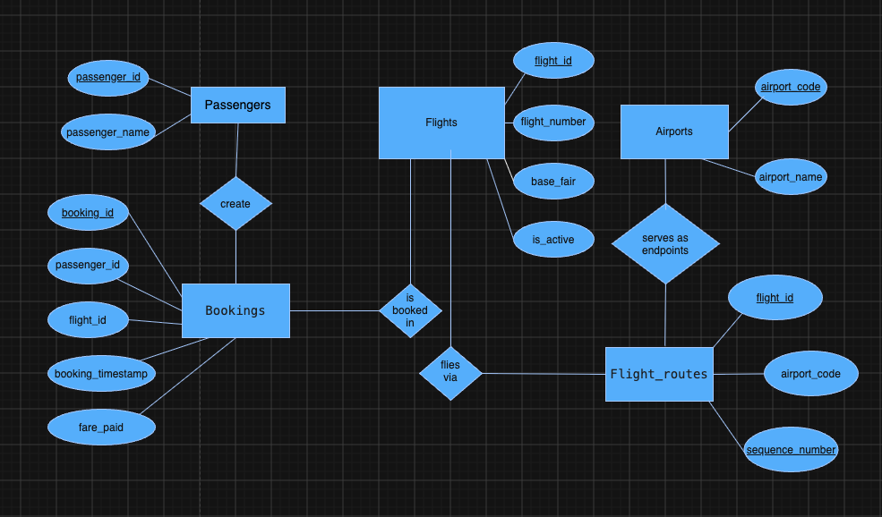

# Airline Booking Database

A PostgreSQL project that models an airline's passengers, flights, routes, and bookings so operations and finance teams can analyze activity, cancellations, revenue, and platform performance.

**Theme:** Airline Booking

## Domain

This project models the data behind an airline booking platform: passengers create reservations, flights provide seat capacity and are scheduled between airports, and bookings record the completed or cancelled event. The schema separates stable reference information—passengers, flights, and airports—from the `bookings` fact table, while `flight_routes` represents the ordered connection between a flight and the airports it serves. This structure keeps passenger and flight details normalized while allowing one flight to include multiple route stops.

The platform must answer operational and financial questions such as: Which flights are active and currently receiving bookings? How much revenue does each flight generate, and how does that compare with its average fare? Which passenger made a booking, and what is its status? Which routes or airports are associated with high-volume flights? What is the cancellation rate for a flight, and is revenue improving or declining over time?

The SQL work also treats missing values and join behavior as reporting questions rather than assumptions. It examines disputed or cancelled bookings, flights with no bookings, and records that may be omitted by inner joins, CTEs, or aggregate queries. The result is a database design and query set that supports customer-service follow-up, operational planning, revenue reporting, and route analysis.

## Database overview

The entity relationship diagram below summarizes the entities and relationships used in the analysis.



The course DDL is provided in [schema/schema.sql](schema/schema.sql). It creates a PostgreSQL 14+ database with identity primary keys, natural and composite keys, foreign keys, delete policies, and check constraints. The Unit 3 reference dataset that supplies the analysis tables and sample rows is [queries/unit3/airline.sql](queries/unit3/airline.sql).

| Table | Purpose in the analysis |
|---|---|
| `passengers` | The actor or customer who made a booking. It contains passenger identity and, in the reference dataset, signup and referral attributes. |
| `flights` | The producer or supply entity, including flight number, origin, capacity, schedule date, and active status. |
| `airports` | The catalog of airports and IATA codes used to describe destinations and routes. |
| `bookings` | The central event table. It records the passenger, flight, booking time, fare, status, bag weight, and optional cancellation reason. |
| `flight_routes` | The junction table that associates flights with airports. In the normalized course schema, each flight stop is keyed by flight and sequence number. |

`bookings` is the high-volume fact table for most analysis. It connects both `passengers` and `flights`, and `fare_paid` is kept separate from any base or scheduled fare because it represents the amount of a specific reservation. Foreign-key restrictions preserve booking and passenger history, while route rows are removed when a flight is deleted. Supporting constraint and design rationale is documented in [schema/constraints.md](schema/constraints.md) and [schema/schema-definition.md](schema/schema-definition.md).

## Query catalogue

### Unit 3 — filtering, text, NULLs, and computed results

| Query | Business question answered |
|---|---|
| [q3_1.sql](queries/unit3/q3_1.sql) | Which active flights have at least 100 seats, and which should be shown first? |
| [q3_1.sql](queries/unit3/q3_1.sql) | What cancellation or dispute reasons appear in the event data, including unexpected NULL values? |
| [q3_1.sql](queries/unit3/q3_1.sql) | Which bookings fall in a fare range or have a selected status, and how can text patterns and missing reasons be handled? |
| [q3_1.sql](queries/unit3/q3_1.sql) | How can flight names and seat capacity be transformed into readable aircraft-size categories? |

> Unit 3 contains five numbered questions in `q3_1.sql` through `q3_3.sql`; the table links all three files because the tasks cover filtering and set or NULL behavior rather than a one-query-per-table split. [airline.sql](queries/unit3/airline.sql) loads the reference dataset.

### Unit 4 — aggregates and performance baselines

| Query | Business question answered |
|---|---|
| [q4_1.sql](queries/unit4/q4_1.sql) | What are the overall booking and fare statistics, and how do volume and average fare vary between flights? |
| [q4_2.sql](queries/unit4/q4_2.sql) | How many bookings and cancellations does each flight have, how should regional subtotals be reported, and what defines high-volume flight performance? |

### Unit 5 — joins and join behavior

| Query | Business question answered |
|---|---|
| [q5_1.sql](queries/unit5/q5_1.sql) | Which passenger booked which flight, which airports are associated with a flight, and how do flights compare within their region or origin country? |
| [q5_2.sql](queries/unit5/q5_2.sql) | Which flights have no bookings, and do inner, left, right, full outer, `NOT EXISTS`, and `EXCEPT` joins identify the same missing activity? |
| [q5_3.sql](queries/unit5/q5_3.sql) | How is PostgreSQL executing joins, and what is the row-growth risk of an accidental Cartesian product? |

### Unit 6 — window functions and reporting patterns

| Query | Business question answered |
|---|---|
| [q6_1.sql](queries/unit6/q6_1.sql) | How does each booking compare with its flight average, and how should flights be ranked or divided into quartiles? |
| [q6_2.sql](queries/unit6/q6_2.sql) | How do fares change from one booking to the next, how does revenue accumulate, and where are long gaps in flight activity? |
| [q6_3.sql](queries/unit6/q6_3.sql) | Which are the highest-fare bookings per flight, and how has monthly revenue changed compared with the previous month? |

## Technical highlights

- **Relational joins:** Queries combine passengers, flights, bookings, and airports through primary/foreign-key relationships. They power customer-service reports and route analysis, but also expose records that disappear in an inner join.
- **Conditional aggregation:** `CASE WHEN` inside `SUM` and `COUNT` calculates total and cancelled bookings in one pass. This provides a consistent numerator and denominator for cancellation rates.
- **CTEs and set operations:** CTEs split baseline calculations into readable stages, while `IN`, `EXISTS`, `EXCEPT`, and outer joins verify that alternative query forms return the same operational result.
- **Window functions:** `AVG OVER`, ranking functions, `LAG`/`LEAD`, and moving or running windows keep booking-level detail while adding flight averages and time comparisons that `GROUP BY` alone would hide.
- **Execution-plan analysis:** `EXPLAIN` and `EXPLAIN ANALYZE` identify sequential scans, hash joins, nested loops, memoization, and primary-key index lookups. This explains how the database answers a query and where larger datasets may require indexing or plan monitoring.

## Findings and recommendations

1. **Cancellation risk is concentrated on particular flights.** Across 200 bookings, 34 were cancelled, for an overall cancellation rate of 17%. Among flights with at least 16 bookings, VN204 had six cancellations (33.3%) and VN211 had five (31.3%), compared with a high-volume baseline near 15.2%. Operations should investigate these two flights for cancellation reasons and temporal or regional patterns, while requiring enough booking volume before interpreting a flight-level rate.

2. **Some flights have no recorded booking activity.** Left-join and set-based analysis identified VN214 and VN215 as the two flights without matching bookings. Their status may reflect inactivity, late setup, missing event data, or a genuinely never-launched schedule. Operations should verify flight schedules and data ingestion before deciding whether to retire, relaunch, or repair records for them.

3. **NULL handling and join type can change a decision.** A filter that compared cancellation reasons directly with `<> 'Payment failed'` excluded NULL reasons and did not count all disputes or cancellations correctly. Reports should use explicit NULL handling and preserve all relevant events. Finance and customer-service teams should therefore correct dashboard filters before making payouts or freeze decisions, and investigate why missing reasons are recorded.

Recommended next steps are to add cancellation reasons to a structured lookup, monitor cancellation and revenue changes by month, and review high-volume outlier flights regularly. A flagged dashboard should distinguish “no matching booking” from “cancelled” or “disputed” rather than presenting both as one generic absence.

## Limitations and future improvements

The sample dataset contains 200 bookings and 15 flights, so it is useful for demonstrating SQL behavior but may not support reliable airline-wide forecasts or statistically stable trends. Small flight volume can magnify a cancellation or fare spike, and the available fields do not show seat occupancy, scheduled departure, refund amount, demand, weather, or the reason for missing bookings.

The next improvement would be to load a larger time-series dataset with one row per schedule or departure, including departure and arrival dates, seat capacity, sales channel, refunds, and operational disruptions. A full lifecycle table would then support occupancy, load factor, revenue yield, cancellation causality, and seasonality analysis. Production constraints should also be checked with a test suite containing valid, invalid, and missing-parent records.

## Video presentation

**Presentation video:** [Add the course presentation video or link here](https://example.com)

Replace the example link with the YouTube, Panopto, Loom, or other course-approved URL before submission.

## How to run it

You need PostgreSQL, `psql`, and a database. The following commands use macOS/Linux-style paths and assume you are in the repository root.

### 1. Create the database and load the Unit 3 reference dataset

```bash
createdb ex603_airline
psql -d ex603_airline -f queries/unit3/airline.sql
```

The reference loader resets and populates the `passengers`, `flights`, `flight_services`, `airports`, `flight_routes`, and `bookings` tables. It can be rerun safely because it drops those tables before rebuilding the dataset.

### 2. Run a query

```bash
psql -d ex603_airline -f queries/unit4/q4_1.sql
```

Replace the final path with any file in `queries/unit3`, `queries/unit4`, `queries/unit5`, or `queries/unit6`.

For an interactive PostgreSQL session:

```bash
psql -d ex603_airline
\i queries/unit6/q6_3.sql
```

### 3. Optional: build the normalized Unit 2 course schema

To create the smaller five-table schema described in the ERD and course DDL rather than loading the Unit 3 reference dataset:

```bash
createdb airline_booking
psql -d airline_booking -f schema/schema.sql
```

The Unit 2 schema and Unit 3 reference dataset have slightly different table structures and column names. Use `queries/unit3/airline.sql` for the SQL catalogue's populated dataset, or create and insert the records required by `schema/schema.sql` before running the Unit 2 reporting exercises.

## Repository structure

- `schema/` — ERD, DDL, table definitions, and constraint rationale
- `queries/unit3/` through `queries/unit6/` — course SQL by unit
- `analysis/` — written findings and assignment reflections
- `screenshots/` — query results and execution-plan evidence
